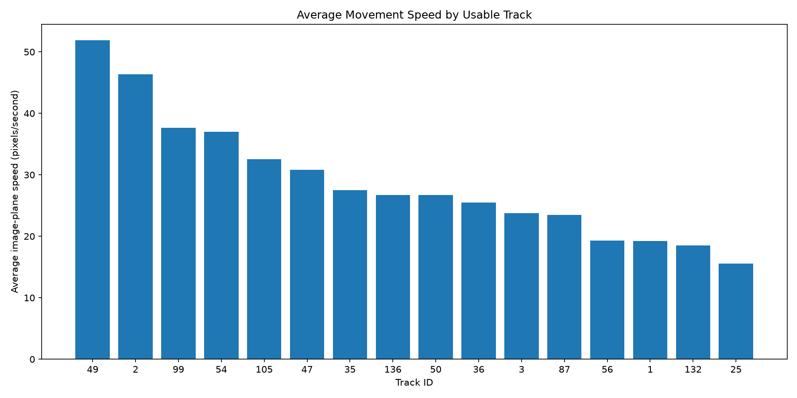
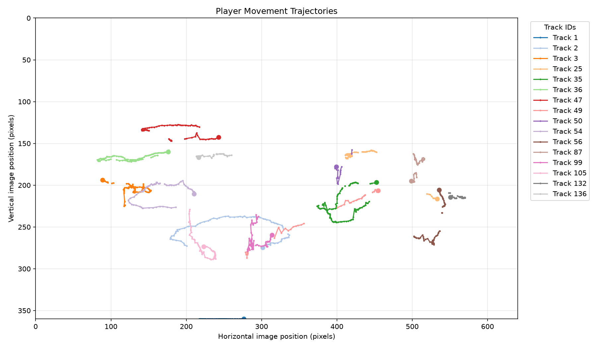
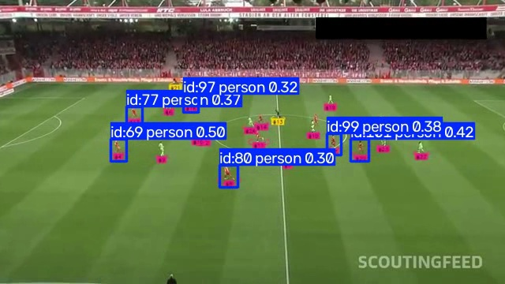

# AI Football Player Tracking & Performance Analysis

An end-to-end computer vision MVP for detecting, tracking, and analysing football players from broadcast match footage.

The project explores how object detection, multi-object tracking, trajectory analysis, and movement analytics can be combined to extract structured player performance information from football video.

---

## 1. Project Overview

## Project Documentation

- [Technical Engineering Case Study](PROJECT_CASE_STUDY.md) — Detailed explanation of the engineering approach, architecture, experiments, results, challenges, and future roadmap.

---

Football performance analysis increasingly relies on accurate player tracking and movement data. However, advanced tracking infrastructure can be expensive and difficult to access, particularly for smaller clubs and football organisations.

This project investigates a computer vision-based approach to extracting player movement information from football footage using accessible machine learning tools.

The system combines:

- YOLO-based player detection
- ByteTrack multi-object tracking
- Tracking continuity analysis
- Player trajectory extraction
- Movement and speed estimation
- Track quality assessment
- Visual analytics and structured CSV outputs

The current implementation is a research-oriented MVP. Its movement measurements are calculated in image-plane coordinates rather than calibrated real-world pitch coordinates.

## 2. Project Objectives

The primary objectives are to:

1. Detect football players in broadcast footage.
2. Track detected players across sampled video frames.
3. Investigate tracking continuity and ID fragmentation.
4. Extract player movement trajectories.
5. Calculate image-plane movement and speed metrics.
6. Identify usable and fragmented tracks.
7. Generate structured outputs for further analysis.
8. Establish a foundation for future real-world pitch calibration and performance analytics.

## 3. Technology Stack

| Technology | Purpose |
|---|---|
| Python | Main programming language |
| YOLO11n | Object detection |
| Ultralytics | Detection and tracking framework |
| ByteTrack | Multi-object tracking |
| OpenCV | Video processing and computer vision |
| NumPy | Numerical computation |
| Pandas | Data processing and analysis |
| Matplotlib | Data visualisation |
| Pytest | Automated testing |
| Git and GitHub | Version control and project publishing |

## 4. System Architecture

The project follows a modular processing pipeline.

```text
Football Match Video
        |
        v
Video Inspection and Frame Sampling
        |
        v
YOLO Player Detection
        |
        v
ByteTrack Multi-Object Tracking
        |
        v
Tracking Observations
        |
        v
Track Continuity and Quality Analysis
        |
        v
Player Movement Analysis
        |
        v
Trajectory and Speed Visualisation
        |
        v
Structured CSV Outputs and Charts
```

### Main processing stages

**Stage 1 — Video processing**

Football footage is inspected to establish its resolution, frame rate, duration, and frame sampling requirements.

**Stage 2 — Player detection**

YOLO11n identifies people in sampled frames.

**Stage 3 — Multi-object tracking**

ByteTrack associates detections across frames and assigns tracking IDs.

**Stage 4 — Tracking analysis**

Tracking observations are examined for track duration, continuity, observation gaps, and fragmentation.

**Stage 5 — Movement analysis**

Player positions are used to calculate displacement and image-plane movement speed.

**Stage 6 — Visualisation**

Movement charts and player trajectory plots are generated for analysis.

## 5. Project Structure

```text
ai-football-player-tracking-analysis/
│
├── data/
│   └── football_test.mp4
│
├── outputs/
│   ├── tracking_observations.csv
│   ├── buffer_60_tracking_observations.csv
│   ├── buffer_60_track_summary.csv
│   ├── experiment_log.csv
│   ├── player_movement_metrics.csv
│   ├── player_movement_metrics_usable.csv
│   ├── player_movement_speed.png
│   ├── player_movement_trajectories.png
│   └── diagnostic images and CSV files
│
├── src/
│   ├── analyze_tracking.py
│   ├── bytetrack_custom.yaml
│   ├── create_transition_sheet.py
│   ├── detect_pitch_intersections.py
│   ├── diagnose_camera.py
│   ├── inspect_pitch.py
│   ├── inspect_trajectory_jumps.py
│   ├── inspect_video.py
│   ├── movement_analysis.py
│   ├── run_pipeline.py
│   ├── test_detection.py
│   ├── verify_calibration_frame.py
│   ├── visualize_movement.py
│   └── visualize_trajectories.py
│
├── tests/
│   └── test_movement_analysis.py
│
├── .gitignore
├── README.md
└── requirements.txt
```

The YOLO model weights and raw video footage are excluded from GitHub to avoid committing large binary files.

## 6. Experimental Setup

The initial tracking experiments used a football video with the following properties:

| Property | Value |
|---|---:|
| Video resolution | 640 × 360 |
| Original frame rate | 30 FPS |
| Video duration | Approximately 90.3 minutes |
| Frames in original video | 162,565 |
| Experiment duration | 10 seconds |
| Sampling rate | 15 FPS |
| Sampled frames | 150 |

The tracking experiments were deliberately restricted to a short video segment to allow controlled comparisons between tracker configurations.

### ByteTrack configuration

The selected experimental configuration used:

```yaml
tracker_type: bytetrack
track_high_thresh: 0.25
track_low_thresh: 0.1
new_track_thresh: 0.25
track_buffer: 60
match_thresh: 0.8
fuse_score: True
```

The extended track buffer was investigated to understand its effect on track continuity when detections temporarily disappear.

## 7. Tracking Experiments

Three configurations were compared.

| Experiment | Confidence | Tracker | Observations | Unique IDs | Visible ID-set changes |
|---|---:|---|---:|---:|---:|
| Baseline | 0.10 | Default ByteTrack | 1,057 | 54 | 101 |
| Confidence 0.25 | 0.25 | Default ByteTrack | 823 | 62 | 127 |
| Buffer 60 | 0.10 | Custom ByteTrack | 1,170 | 36 | 89 |

### Selected experiment: Buffer 60

The custom ByteTrack configuration produced:

- 1,170 tracking observations
- 36 unique tracking IDs
- 89

## Visual Results

The following visualisations were generated by the movement-analysis pipeline using the selected Buffer 60 tracking experiment.

### 1. Player Movement Speed



Average image-plane movement speed for the 16 tracks classified as usable.

**Measurement unit:** Pixels per second.

### 2. Player Movement Trajectories



Visual representation of observed player trajectories using bounding-box foot positions.

The horizontal and vertical axes represent image coordinates in pixels.

### Interpretation

These visualisations demonstrate how raw tracking observations can be transformed into structured movement analytics.

The results are based on a short sampled video segment and should not be interpreted as validated full-match player performance statistics.

### 3. Multi-Object Tracking Preview



Representative frame showing detected players, bounding boxes, and assigned tracking IDs from the multi-object tracking pipeline.

Tracking IDs are algorithm-assigned identifiers and are not verified persistent player identities. Some label overlap and ID fragmentation remain limitations of the current tracking implementation.